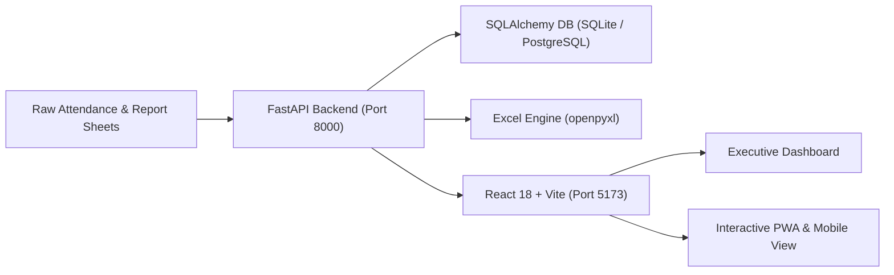

# Hontime — HR Attendance, Report & Productivity Intelligence Platform

> **Enterprise Workforce Analytics, Punctuality Tracking, Compliance Audit, and Mathematical Reconciliation Platform**

[](backend/tests)
[](frontend)
[](frontend/public/manifest.json)
[](frontend/capacitor.config.json)

---

## 🌟 Overview

**Hontime** is a modern HR intelligence and compliance auditing platform built for automated ingestion, processing, and multi-dimensional analysis of daily attendance logs and work reports. 

The platform bridges raw biometric/punch-in sheets with daily task reports, resolves naming mismatches, validates strict mathematical reconciliation across departments, flags compliance exceptions, and generates formatted corporate 9-sheet Excel workbooks.

---

## 🚀 Key Features

### 1. Ingestion & Intelligent Reconciliation
- **Dual-File Ingestion**: Ingests daily biometric punch records and daily task submission sheets (Excel/CSV).
- **Smart Name Matching**: Normalizes employee identities across different file conventions, nicknames, and titles.
- **Mathematical Reconciliation**: Enforces that Total Roster = Present + Absent, and Reports Filed + Reports Not Submitted = Present Today.
- **Resilient 9-Sheet Excel Export**: Generates a 9-sheet executive workbook (`Attendance_Analysis_YYYY-MM-DD.xlsx`) with automated fallback reconstruction directly from database records.

### 2. Operational Attention & Exceptions Hub
- Categorized tabs: **Missing Reports**, **Frequent Late Arrivals**, **Out-of-Location Violations**, **Chronic Non-Submitters**, and **Absences**.
- Real-time search across names, employee IDs, and departments.
- Click-to-inspect employee slide-over profile with 15-day attendance history and productivity curves.

### 3. Dual UI Modes: Executive Analytics vs Instagram Feed
- **Executive Analytics**: KPI summary cards, department attendance breakdown, late arrival distribution, and quality rating pie charts.
- **Highlights Feed**: Instagram-inspired story carousels, employee recognition cards, interactive kudos/reactions, and daily department leaderboards.

### 4. Cross-Platform & Mobile Ready
- **Desktop Launcher**: Double-click `start.bat` for automatic 1-click startup of backend and frontend.
- **Auto-Start**: Configure Windows to launch on system boot with `enable_autostart.ps1`.
- **Desktop Shortcut**: One-click creation via `create_shortcut.ps1`.
- **PWA & Native Mobile**: Full offline-ready Progressive Web App with manifest and service worker, plus Capacitor configuration for native Android and iOS builds.

---

## 🛠️ Architecture & Tech Stack



- **Backend**: Python 3.11+, FastAPI, SQLAlchemy, openpyxl, pandas, Uvicorn, Gunicorn.
- **Frontend**: React 18, Vite, Tailwind CSS, Recharts, Lucide Icons, Axios.
- **Mobile / Native**: Capacitor 6 (Android Studio / Xcode support) & PWA.

---

## ⚡ Quick Start (Local Windows)

### Option A: 1-Click Launch (Native Desktop App)
Simply double-click `start.bat` in the project root:
- Starts the service silently with **ZERO Command Prompt windows** in the taskbar.
- Launches Microsoft Edge / Google Chrome in dedicated **App Mode** (frameless window, no URL bar, no tabs, just like Instagram/Google desktop apps).

To stop all background services cleanly:
```batch
stop.bat
```

### Option B: Create Desktop Shortcut with App Icon
In PowerShell:
```powershell
powershell -ExecutionPolicy Bypass -File create_shortcut.ps1
```
This creates a **Hontime Portal** desktop shortcut with the official app icon that launches directly into standalone app mode.

### Option C: Enable Silent Auto-Start on System Boot
In PowerShell:
```powershell
powershell -ExecutionPolicy Bypass -File enable_autostart.ps1
```

---

## 🔐 Default Credentials

| Role | Email | Password | Access Level |
| :--- | :--- | :--- | :--- |
| **Administrator** | `admin@hontime.com` | `admin123` | Full access (Upload, Delete, Audit, Settings) |
| **Viewer** | `viewer@hontime.com` | `viewer123` | Read-only analytics & reports |

---

## ☁️ Cloud Deployment

### 1. Backend on Render
The project contains `backend/render.yaml` and `backend/Procfile`.
- Push repository to GitHub.
- Create a new **Web Service** on [Render](https://render.com).
- Root Directory: `backend`
- Build Command: `pip install -r requirements.txt`
- Start Command: `gunicorn -k uvicorn.workers.UvicornWorker app.main:app --bind 0.0.0.0:$PORT`
- Set `SECRET_KEY` and optional `DATABASE_URL` (PostgreSQL).

### 2. Frontend on Vercel
The project includes `frontend/vercel.json` with API rewrites.
- Import the `frontend` folder into [Vercel](https://vercel.com).
- Build Command: `npm run build`
- Output Directory: `dist`
- Environment Variables:
  - `VITE_API_URL`: URL of your Render backend (e.g. `https://hontime-backend.onrender.com/api`).

---

## 🧪 Testing

To execute the backend business logic and reconciliation test suite:
```powershell
cd backend
python -m pytest
```

To build and verify the frontend production bundle:
```powershell
cd frontend
npm run build
```

---

## 📄 License & Attribution
Designed & Engineered for **Hontime** Enterprise Operations. All rights reserved.

